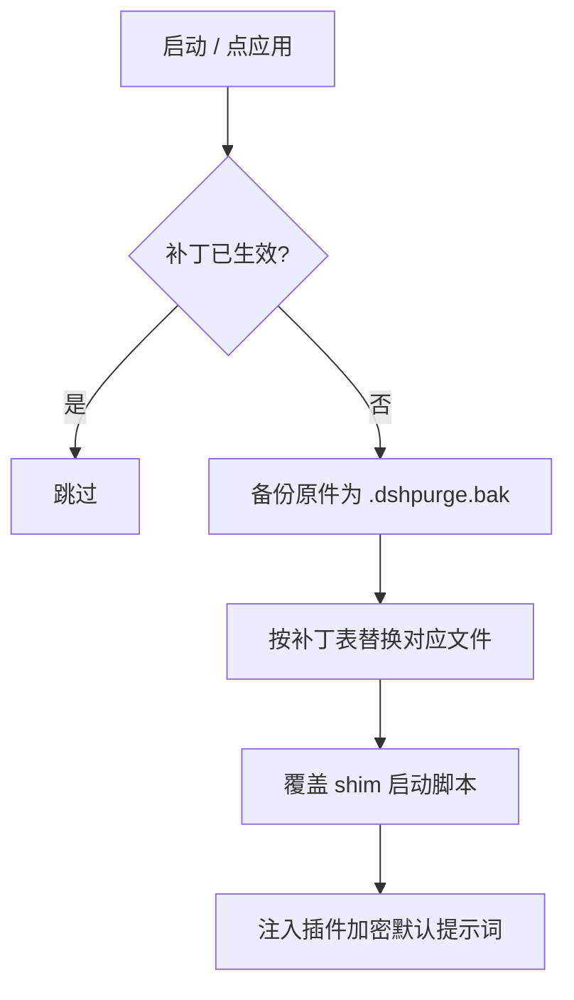
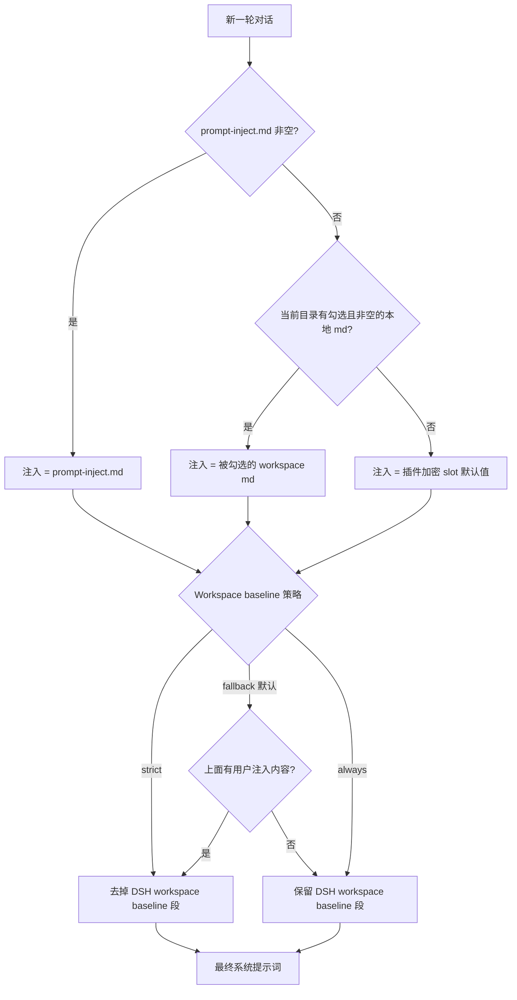

# dsh-purge 使用教程

> 对象：本仓库 `YuJunZhiXue/dsh-purge` **v1.1.71**（默认分支 `master`）
> 目标宿主：官方 DeepSeek Harness **0.2.1-rc.2**（`dsh target = 0.2.1-rc.2`）
> 许可证：MIT（非盈利公益项目，严禁商用倒卖；二次开发必须署名，详见仓库 README）
>
> 本教程以**本机真实环境**为基准书写，非通用模板：
>
> | 项 | 本机实测值 |
> | --- | --- |
> | 工作副本 | `C:\Users\Administrator\Desktop\dsh-purge` |
> | `$DSH_HOME` | `C:\Users\Administrator\.dsh` |
> | profile | `web` / `desktop` / `headless` |
> | 已装版本 | 两侧均 `1.1.71`，状态 `link:` 到开发目录 |
> | Node.js | `v24.21.0`（`C:\Program Files\nodejs\node.exe`） |
> | `dsh` CLI | `C:\Users\Administrator\AppData\Local\Programs\DeepSeek Harness\resources\runtime\cli\bin\dsh.cmd` |
> | `git` | 未安装（安装方式见 §1.3） |
> | `pnpm` | 不在 PATH（走 dsh 内置 runtime，见 §2.2） |

---

## 目录

1. [它是什么](#1-它是什么)
2. [**安装需求**](#2-安装需求) ← 必读，装不上都在这节
3. [安装](#3-安装)
4. [清洗项总表（X 标记）](#4-清洗项总表x-标记) — 全 82 条
5. [使用](#5-使用)
6. [内置红外技能包](#6-内置红外技能包)
7. [自己的服务器免禁名单](#7-自己的服务器免禁名单)
8. [还原 / 卸载 / 更新](#8-还原--卸载--更新)
9. [故障排查](#9-故障排查)
10. [命令速查卡](#10-命令速查卡)

---

## 1. 它是什么

**dsh-purge** 是装在本机官方 DeepSeek Harness 上的插件，做两件事：

| 模块 | 作用 |
| --- | --- |
| **清洗** | 把宿主的两层拦截面分开：**提示词层**（注入的人设、免责、审批语句）与**代码层**（审批默认值、沙箱模式、文件围栏、工具上限）。补丁共 **82 条**，分组展示，可应用 / 还原 / 卸载，提示词和规则集可编辑 |
| **演练台** | 授权后才可进入。查看资产、技能、本机环境。数据落在 `$DSH_HOME/redteam` |

关键设计点：

- **不改 Harness 源码仓库**，只改本机已安装的 `@deepseek-ai/*` 包。每个被改文件先备份为 `<文件>.dshpurge.bak`，可幂等重复应用、可回滚。
- **不写死盘符**。路径按 `$DSH_HOME` → dsh 启动器旁的 `.dsh` → `~/.dsh` 顺序探测。
- 身份来自**插件内加密提示词**（提示词框默认显示的那份），不读宿主磁盘上的提示词文件。
- 应用成功会**自动重启一次**宿主；补丁没打完不重启。

### 宿主双层结构（理解这个才不会误判）

Harness 不直接把问题交给模型，它还会在运行时改提示词、审批门、沙箱和会话格式。所以「模型答不答」不等于「模型拒没拒」——很可能是宿主拦的。清洗的意义就是把这两层分开，做受控评测。





---

## 2. 安装需求

### 2.1 硬性需求

| 需求 | 要求 | 本机状态 | 说明 |
| --- | --- | --- | --- |
| **DeepSeek Harness** | 必须是 **0.2.x** | ✅ 0.2.1-rc.2 | 0.1.x 用 1.1.39 及更早版本，别混装 |
| **宿主形态** | 官方 `dsh web` 或官方桌面 EXE | ✅ 两者都有 | 社区桌面端不维护 |
| **Node.js** | **≥ 18** | ✅ v24.21.0 | 官方 dsh 自带 runtime 亦可 |
| **Node.js（Windows）** | **≥ 22** 才不闪黑窗 | ✅ v24.21.0 | < 22 时启动会闪 cmd 窗口 |
| **profile** | `web` 和 `desktop` **分开安装、分开应用** | ✅ 两个都在 | Web 的包进不了桌面端，反之亦然 |

> **Node 版本自检**：`node --version`。低于 18 直接装不上；Windows 上低于 22 虽然能用但会闪窗。

### 2.2 包管理器需求

- **npm registry 可达**（默认路径），或者
- **本地目录 / tar.gz**（离线路径），或者
- **pnpm** —— 仅在手动安装时需要。**本机 pnpm 不在 PATH**，所以手动路线要用 dsh 自带的 Node / pnpm，或直接跳过手动路线走 CLI 安装。

> 三个 profile 里 `desktop` 和 `web` 已经装好，`headless` 没装。要装 `headless` 就按同一套命令换 `--profile headless`。

### 2.3 Git（可选）

**本机没装 git**。这不影响安装——三种途径都不强制 git：

| 途径 | 需要 git |
| --- | --- |
| `dsh plugin add dsh-purge`（npm） | ❌ |
| `dsh plugin add <tar.gz 或 zip 链接>` | ❌ |
| 手动放目录 + 改 profile | ❌（下载 zip 解压即可） |
| `git clone` 到 `plugins/` | ✅ 需要 |

需要 git 时（Windows）：

```powershell
winget install --id Git.Git -e --source winget
# 或下载 https://git-scm.com/download/win 安装后重开终端
```

### 2.4 权限需求

| 操作 | 需要的权限 |
| --- | --- |
| 写 `$DSH_HOME`（`C:\Users\Administrator\.dsh`） | 普通用户权限 |
| 改 `@deepseek-ai/*` 包文件 | 若 dsh 装在 `Program Files` 下，**需要管理员** |
| 改 shim 脚本（`dsh.cmd` / `dsh.ps1`） | 同 dsh 安装目录权限 |
| 桌面端解包（asar sealed） | 首次可能弹 UAC |

> 本机 dsh 装在 `C:\Users\Administrator\AppData\Local\Programs\...`（用户目录内），**不需要管理员**。

### 2.5 网络需求

- 安装阶段：能访问 npm registry 或 GitHub。
- 运行阶段：**清洗、回滚、卸载全部在本机文件与本机进程内完成**，不对任何外部主机发包。
- 只有开启「检测更新」时才会访问插件自己的 GitHub 仓库核对版本。

### 2.6 使用前置合规（要进演练台必读）

- 只在自己**有权管理**的本机、离线靶标、或**已书面授权**的演练环境使用。
- 中国大陆 / 香港 / 澳门地址默认禁止，唯一例外是**事先登记的那台服务器**（见 §7）。
- 演练台首次进入需读声明、等倒计时、滚到文末、勾选三项。**清洗不需要这一步**。

### 2.7 一键自检脚本

复制到 PowerShell 直接跑，一次核对全部前置条件：

```powershell
Write-Host "=== dsh-purge 前置自检 ===" -ForegroundColor Cyan

# 1. 宿主
$dsh = Get-Command dsh -ErrorAction SilentlyContinue
if ($dsh) { Write-Host "[OK] dsh -> $($dsh.Source)" } else { Write-Host "[!!] dsh 不在 PATH" -ForegroundColor Yellow }

# 2. Node 版本
$nv = (node --version) -replace 'v',''
$major = [int]($nv.Split('.')[0])
Write-Host "[$(if($major -ge 22){'OK'}else{'!!'})] Node v$nv  (>=18 必须, >=22 才不闪窗)"

# 3. DSH_HOME
$cands = @()
if ($env:DSH_HOME) { $cands += $env:DSH_HOME }
$cands += "$env:USERPROFILE\.dsh"
$cands += "$env:APPDATA\DeepSeek Harness\dsh-home"
$cands += "$env:LOCALAPPDATA\DeepSeek Harness\dsh-home"
$cands | Select-Object -Unique | ForEach-Object {
  if ($_ -and (Test-Path (Join-Path $_ "profiles"))) { Write-Host "[OK] DSH_HOME 候选: $_" }
}

# 4. 各 profile 装没装
$home_ = "$env:USERPROFILE\.dsh"
foreach ($p in @('web','desktop','headless')) {
  $pj = Join-Path $home_ "profiles\$p\package.json"
  if (Test-Path $pj) {
    $n = (Get-Content $pj -Raw | ConvertFrom-Json).name
    $has = Test-Path (Join-Path $home_ "profiles\$p\node_modules\dsh-purge")
    Write-Host "  profile $p ($n)  dsh-purge=$(if($has){'已装'}else{'未装'})"
  } else {
    Write-Host "  profile $p  不存在" -ForegroundColor DarkGray
  }
}

# 5. 备份情况
$bak = (Get-ChildItem "$home_\profiles" -Recurse -File -Filter '*.dshpurge.bak' -ErrorAction SilentlyContinue).Count
Write-Host "[i] 现存 .dshpurge.bak 备份: $bak"
```

---

## 3. 安装

### 3.1 三步铁律（装完必须做，缺一步都不生效）

> 只把插件写进 profile **还不会**改 `@deepseek-ai`。

1. **退出并重新打开**刚装的那个宿主：Web 关掉 `dsh web` 再开；桌面端退出托盘再打开 EXE。
2. 在**这个宿主**里点会话标题旁的 **dsh-purge** → **清洗** → **应用**。宿主的设置页里没有这个条目。
3. 「应用」成功后会自动重启一次，让补丁进入当前进程。没做完不会重启。

**Web 的控件只动 Web，桌面端的只动桌面应用。不要在一个宿主里点另一个宿主的应用。**

### 3.2 方式 A：命令行安装（推荐）

**Web 端**

```sh
dsh plugin --profile web add dsh-purge
```

**桌面端**

```sh
dsh plugin --profile desktop add dsh-purge
```
> DSH 0.2.1-rc.2 提示：dsh plugin add 只安装包，不一定会把它加入 dsh.profile.bundles。Windows 可运行安装-dsh-purge.cmd 自动追加（--check 仅试运行）；手动安装则把 dsh-purge 加入目标 profile 已有的 dsh.profile.bundles 数组。


**当前目录已经是本仓库时**，把包名换成 `.`：

```sh
cd C:\Users\Administrator\Desktop\dsh-purge
dsh plugin --profile web add .
dsh plugin --profile desktop add .
```

**registry 上不去时**，同一个 `--profile`，把目标换成 tar.gz：

```sh
dsh plugin --profile web add https://github.com/YuJunZhiXue/dsh-purge/archive/refs/heads/master.tar.gz
```

已知本机现状（仅供参考，不要重复装）：

| profile | 状态 | 指向 |
| --- | --- | --- |
| `web` | 已装 1.1.71 | `link:C:/Users/Administrator/Documents/Codex/.../work/dsh-purge` |
| `desktop` | 已装 1.1.71 | 同上 |
| `headless` | 未装 | — |

> **注意**：两个 profile 目前是 `link:` 到旧的开发目录，**不是**桌面这份新副本。要让桌面副本生效，见 §3.5。

### 3.3 方式 B：插件市场 / `dsh://` 一键安装

- [插件市场](https://dsh-plugin.org/plugins/yujunzhixue/dsh-purge) 一键安装会按本仓库反查 npm，命中后装 `dsh-purge`。目录页可能仍写 `github:` —— 按钮若退回 git，改用方式 A 的命令。
- 桌面客户端也可以用 `dsh://` 链接唤起（仓库 README 里有按钮）。

### 3.4 方式 C：手动安装（CLI 装不上 / 离线 / dsh 不在 PATH）

<details>
<summary><strong>完整手动步骤（点击展开）</strong></summary>

**Step 1 · 找到真正在用的 `$DSH_HOME`**

认目录：名字是 `.dsh`（官方 EXE 偶见 `dsh-home`），里面有 `profiles`，且至少有一个 `profiles/<名>/package.json`。

查找顺序：`DSH_HOME` 环境变量 → 安装根旁边的 `.dsh`（便携包）→ `%USERPROFILE%\.dsh` → `%APPDATA%` / `%LOCALAPPDATA%\DeepSeek Harness\dsh-home`。

确认方法：`profiles/web/package.json` 里 `"name"` 应为 `dsh-profile-web`（桌面是 `dsh-profile-desktop`）。

本机已确认：`C:\Users\Administrator\.dsh`，三个 profile 名字都对得上。

**Step 2 · 把插件放到 `$DSH_HOME/plugins/dsh-purge`**

目录名必须是 `dsh-purge`，其 `package.json` 里 `"name"` 也必须是 `dsh-purge`。

```sh
# 有 git（本机没有，需先装）
git clone https://github.com/YuJunZhiXue/dsh-purge.git "$DSH_HOME/plugins/dsh-purge"
```

**没有 git**：下载 [master.tar.gz](https://github.com/YuJunZhiXue/dsh-purge/archive/refs/heads/master.tar.gz) 或 [master.zip](https://github.com/YuJunZhiXue/dsh-purge/archive/refs/heads/master.zip)，解压后把 `dsh-purge-master` 改名为 `dsh-purge`，整个文件夹放到 `plugins` 下。

> **已有本仓库副本就复制整个目录，不要只拷几个 `.js`。**
> 桌面这份副本（`C:\Users\Administrator\Desktop\dsh-purge`）可直接用。

```powershell
$h = "$env:USERPROFILE\.dsh"
New-Item -ItemType Directory -Force -Path "$h\plugins" | Out-Null
Copy-Item 'C:\Users\Administrator\Desktop\dsh-purge' "$h\plugins\dsh-purge" -Recurse -Force
Get-Item "$h\plugins\dsh-purge\package.json" | Select-Object FullName
```

**Step 3 · 只改对应 profile 的 `package.json`，先备份**

- Web → `$DSH_HOME/profiles/web/package.json`
- 桌面 → `$DSH_HOME/profiles/desktop/package.json`

**只追加两处**，原有依赖和 bundle 全部留着：

1. `dependencies` 增加 `"dsh-purge": "file:../../plugins/dsh-purge"`
2. `dsh.profile.bundles` **末尾**追加 `"dsh-purge"`（已有就不要再加）

```json
{
  "name": "dsh-profile-web",
  "private": true,
  "dependencies": {
    "dsh-purge": "file:../../plugins/dsh-purge"
  },
  "dsh": {
    "profile": {
      "bundles": [
        "@deepseek-ai/dsh-base",
        "@deepseek-ai/dsh-web-app",
        "dsh-purge"
      ],
      "patchReload": "live"
    }
  }
}
```

JSON 要点：新增项前面有逗号、最后一项后面没有多余逗号；`file:../../plugins/dsh-purge` **不要改成绝对路径**；`patchReload`、其它插件、版本号都不要动；`"dsh-purge"` 不要写两次；桌面端没有 `dsh-web-app` 就不要硬加。

**Step 4 · 只在刚改的那个 profile 目录装依赖**

```sh
cd "$DSH_HOME/profiles/web"   # 或 profiles/desktop
pnpm install
```

- `cd` 要进 **profile 目录**，别在仓库根或 `$DSH_HOME` 根。
- 本机 `pnpm` 不在 PATH → 用官方 `dsh` 自带的 Node / pnpm。
- 成功标志：出现 `profiles/<web|desktop>/node_modules/dsh-purge/package.json`。
- 报 `Could not resolve` → 检查 `file:` 路径。JSON 解析失败 → 修逗号或还原备份。

**Step 5 · 完全退出该宿主 → 再启动 → 点「应用」**

和 §3.1 三步一样。没出现按钮多半是改错了另一份 `.dsh`，回 Step 1 核对。

</details>

### 3.5 让桌面这份副本成为生效源（可选，本机特有）

本机两个 profile 现在 `link:` 到旧目录，桌面这份是**独立副本**。两种处理：

**方案 1 · 保持副本（默认，零风险）**
桌面副本只作阅读 / 二次开发用，生效的仍是旧目录。改代码想生效就改旧目录，或走方案 2。

**方案 2 · 把 link 指到桌面副本**

```powershell
$h = "$env:USERPROFILE\.dsh"
$dst = 'C:\Users\Administrator\Desktop\dsh-purge'

foreach ($p in @('web','desktop')) {
  $f = "$h\profiles\$p\package.json"
  Copy-Item $f "$f.bak-before-desktop-$(Get-Date -Format yyyyMMddHHmmss)"   # 先备份
  $j = Get-Content $f -Raw | ConvertFrom-Json
  $j.dependencies.'dsh-purge' = "link:$($dst -replace '\\','/')"
  $j | ConvertTo-Json -Depth 10 | Set-Content $f -Encoding UTF8
  Write-Host "[OK] $p -> $($j.dependencies.'dsh-purge')"
  Get-Content $f -Raw
}
```

改完：**完全退出宿主 → 重启 → 点「应用」**。

**方案 3 · 断链，改为就地安装**

```sh
cd C:\Users\Administrator\Desktop\dsh-purge
dsh plugin --profile web remove dsh-purge
dsh plugin --profile web add .
```

### 3.6 怎样算装上了

三条都满足才算：

- [ ] 会话标题旁有 **dsh-purge**，点开后在「清洗」里能点「应用」
- [ ] 聊天里 `/purge status` 能打出 `DSH_HOME` 和补丁列表，路径是你正在用的那一份
- [ ] 没装的可选包（例如梁神）显示跳过，**不挡住**应用完成

### 3.7 交给 AI 助手安装（可复制话术）

```
安装 DeepSeek Harness 插件 dsh-purge，Web 和官方桌面端都要装。
不要全盘搜索，不要读或改其它文件，不要应用设置，也不要重启应用。

dsh 不在 PATH 就告诉用户后停止。当前目录已是本仓库时，把下面两条里的包名都换成 `.`。
npm registry 上不去，把包名换成 https://github.com/YuJunZhiXue/dsh-purge/archive/refs/heads/master.tar.gz
某个 profile 不存在就跳过那一条，另一条照装。

Web 端：    dsh plugin --profile web add dsh-purge
桌面端：    dsh plugin --profile desktop add dsh-purge

命令结束后，提醒用户：Web 完全退出并重启 dsh web；桌面端退出托盘再打开 EXE。
各自点会话标题旁的 dsh-purge，在「清洗」里点「应用」。然后停止。
```

### 3.8 配置文件默认值

插件配置在 `cordis.patch.yml`：

```yaml
- insert:
    - id: dsh-purge
      name: 'dsh-purge'
      config:
        enabled: true
        autoApplyOnStart: false
        autoUpdateOnStart: false
        autoRevertOnMissing: false
        injectOnce: false
        stripMnemon: true
        verbose: false
        postPrompt: ""
        postPromptOrder: 5100
        autoRetry: true          # 会话出错自动重试
        retryMax: 3
        autoContinue: false      # 断流自动「继续」
        continueMax: 3
        continueText: "继续"
        capabilityProtocol: true
        hooksDenyBypass: true
```

---

## 4. 清洗项总表（X 标记）

**格式**：`[X]` = 本版本已内置该清洗项；`[ ]` = 尚未应用（勾选式，本表按「已内置」全标 X，实际是否生效以 `/purge status` 的 ✓ / ✗ 为准）。

**总计 82 条**，按层分布：

| 层 | 条数 |
| --- | --- |
| 代码 | 46 |
| 提示词 | 25 |
| 工具 | 8 |
| 0.2.0 兼容 | 2 |
| 0.1.5 兼容 | 1 |
| **合计** | **82** |

### 4.1 完整清单

| X 标记 | # | 补丁名 | 层 |
| :---: | ---: | --- | --- |
| [X] | 1 | `WORKSPACE_CONTEXT_INTRO` | 提示词 |
| [X] | 2 | `REPLACEMENT_WORKSPACE_CONTEXT_INTRO` | 提示词 |
| [X] | 3 | `SCOPE_INTRO` | 提示词 |
| [X] | 4 | `SYSTEM_PROMPT_PERSONA` | 提示词 |
| [X] | 5 | `APPROVAL_NEVER_SENTENCE` | 提示词 |
| [X] | 6 | `SANDBOX_DENY_FILE_WRITE` | 代码 |
| [X] | 7 | `SANDBOX_MODE_DEFAULT` | 代码 |
| [X] | 8 | `APPROVAL_POLICY_DEFAULT` | 代码 |
| [X] | 9 | `APPROVAL_AUTO_GRANT` | 代码 |
| [X] | 10 | `APPROVAL_CONFIG_DEFAULT_NEVER` | 代码 |
| [X] | 11 | `APPROVAL_NEVER_SENTENCE_BYPASS` | 提示词 |
| [X] | 12 | `APPROVAL_ASK_SENTENCE_BYPASS` | 提示词 |
| [X] | 13 | `ESCALATION_WIDENING_EXEMPT` | 代码 |
| [X] | 14 | `ESCALATION_GRANT_UNCONDITIONAL` | 代码 |
| [X] | 15 | `SANDBOX_CONFINE_PASSTHROUGH` | 代码 |
| [X] | 16 | `FS_FENCE_DISABLED` | 代码 |
| [X] | 17 | `FS_OBSERVATION_INTENT_FREE` | 代码 |
| [X] | 18 | `REPEAT_TOOL_REMINDER_DISABLED` | 代码 |
| [X] | 19 | `TOOL_RESULT_PRUNER_DISABLED` | 代码 |
| [X] | 21 | `BASH_TIMEOUT_RESTORE` | 代码 |
| [X] | 22 | `READ_CAPS_RAISED` | 代码 |
| [X] | 23 | `SUBAGENT_MAXDEPTH_RAISED` | 代码 |
| [X] | 24 | `PRESET_FETCH_ENABLED` | 代码 |
| [X] | 25 | `HARNESS_IDENTITY_STRIP` | 提示词 |
| [X] | 26 | `MINIMAL_PERSONA_PURGE` | 提示词 |
| [X] | 28 | `LIANGSHEN_PHASE1_KEEP_INJECT` | 提示词 |
| [X] | 29 | `TOOL_WEB_UNTRUSTED_NEUTRAL` | 工具 |
| [X] | 30 | `HOOKS_CLAUDE_DENY_ALLOW` | 工具 |
| [X] | 31 | `HOOKS_CODEX_DENY_ALLOW` | 工具 |
| [X] | 32 | `WEB_SURFACE_IDENTITY_NEUTRAL` | 提示词 |
| [X] | 33 | `TOOL_SHELL_DENIAL_PROMPT` | 提示词 |
| [X] | 34 | `SANDBOX_HINT_NEUTRAL` | 提示词 |
| [X] | 35 | `ESCALATION_NEVER_REJECT` | 代码 |
| [X] | 36 | `TOOL_FS_ESCALATION_SCHEMA` | 提示词 |
| [X] | 37 | `SUBAGENT_SCOPE_LOCK_NEUTRAL` | 提示词 |
| [X] | 38 | `PERSONA_TEXT_PREFIX_ALIAS` | 代码 |
| [X] | 39 | `SESSION_V0_PLUGIN_SUMMARY_ALIAS` | 代码 |
| [X] | 40 | `COMPLETE_PROMPT_KEEP_INJECT` | 0.1.5 兼容 |
| [X] | 42 | `SETTINGS_LEGACY_API` | 代码 |
| [X] | 43 | `WEB_PRESET_IDENTITY_STRIP` | 提示词 |
| [X] | 45 | `OFFICIAL_DESKTOP_UPDATE_HANDOFF` | 代码 |
| [X] | 46 | `OFFICIAL_DESKTOP_UPDATE_ASCII` | 代码 |
| [X] | 47 | `ANTHROPIC_OAUTH_NO_CLAUDE_IDENTITY` | 0.2.0 兼容 |
| [X] | 48 | `TOOL_SHELL_DELETE_MOVE_NEUTRAL` | 工具 |
| [X] | 49 | `ANTHROPIC_OAUTH_CLI_NEUTRAL` | 0.2.0 兼容 |
| [X] | 50 | `SESSION_REFERENCE_FRAMING_NEUTRAL` | 提示词 |
| [X] | 51 | `FRESH_SESSION_FULL_ACCESS` | 代码 |
| [X] | 52 | `SESSION_LOG_UPLOAD_DEFAULT_OFF` | 代码 |
| [X] | 53 | `WEB_SURFACE_PROHIBITION` | 提示词 |
| [X] | 54 | `DELIVERABLE_DO_NOT` | 提示词 |
| [X] | 55 | `SYSTEM_PROMPT_REPLACE_HEAD` | 代码 |
| [X] | 56 | `REWIND_HIDE_CUT_ONLY` | 代码 |
| [X] | 57 | `DEEPSEEK_SYSTEM_ROLE` | 代码 |
| [X] | 58 | `REWIND_SKIP_DERIVE` | 代码 |
| [X] | 59 | `OFFICIAL_AUTO_REVIEW_PASSTHROUGH` | 代码 |
| [X] | 60 | `OFFICIAL_RUN_CODE_APPROVAL_NEUTRAL` | 工具 |
| [X] | 61 | `OFFICIAL_SANDBOX_POLICY_NEUTRAL` | 提示词 |
| [X] | 62 | `OFFICIAL_TOOL_ASK_FAILOPEN` | 代码 |
| [X] | 63 | `OFFICIAL_PLAN_MODE_NEUTRAL` | 提示词 |
| [X] | 64 | `HOOKS_STOP_STEER_NEUTRAL` | 工具 |
| [X] | 65 | `HOOKS_PRESTEP_REJECT_NEUTRAL` | 工具 |
| [X] | 66 | `SYSTEM_PROMPT_RENDER_GUARD` | 代码 |
| [X] | 67 | `AGENT_LOOP_MESSAGES_GUARD` | 代码 |
| [X] | 68 | `SYSTEM_NODES_CONTENT_GUARD` | 代码 |
| [X] | 69 | `MODEL_STREAM_RELEASE` | 代码 |
| [X] | 70 | `PRESET_SHELL_NETWORK` | 提示词 |
| [X] | 71 | `LIANGSHEN_IDENTITY_LINE` | 提示词 |
| [X] | 72 | `MESSAGES_SYSTEM_CURRENT` | 代码 |
| [X] | 73 | `PRESET_BASH_MIRROR_LINE` | 提示词 |
| [X] | 74 | `ASSEMBLE_BEFORE_PRESTEP` | 代码 |
| [X] | 75 | `REWIND_RESET_TODOS` | 代码 |
| [X] | 76 | `PRESET_UNRESTRICTED_IDENTITY_STRIP` | 提示词 |
| [X] | 77 | `REWIND_DROP_SENT_ON_APPEND` | 代码 |
| [X] | 78 | `OVERLAY_RESTORE_FROM_BAK` | 代码 |
| [X] | 80 | `MINIMAL_OFFICIAL_TOOLSET` | 工具 |
| [X] | 82 | `DESKTOP_SHELL_PROFILE_FALLBACK` | 代码 |
| [X] | 83 | `DESKTOP_HOST_CLOSE_NO_FATAL` | 代码 |
| [X] | 84 | `DESKTOP_HOST_CLOSE_CODE0_NO_FAIL` | 代码 |
| [X] | 85 | `SESSION_PROMPT_ALWAYS_FOLLOWUP` | 代码 |
| [X] | 86 | `SESSION_STEER_ALWAYS_FOLLOWUP` | 代码 |
| [X] | 87 | `HUNG_PROMPT_LF_NEEDLE` | 代码 |
| [X] | 88 | `HUNG_PROMPT_STRICT_NEEDLE` | 代码 |

### 4.2 按功能分组的阅读版（同一条清洗的升级链）

界面上**合成一行**展示的组：

| 组 | 含补丁 | 关注点 |
| --- | --- | --- |
| `disclaimer` | #1, #2, #3 | 工作区上下文 / 免责段 |
| `approval_sentence` | #5, #11, #12 | 审批语句（never / bypass） |
| `approval_policy` | #8, #9, #10 | 审批策略默认值 |
| `desktop_update` | #45, #46 | 桌面端更新交接 |
| `desktop_close` | #83, #84 | 桌面端关闭不致命 |
| `followup` | #85, #86 | 会话强制跟进 |
| `hang` | #87, #88 | 卡死的提示词探针 |
| `hooks_deny` | #30, #31 | Claude / Codex hooks 允许表 |
| `hooks_steer` | #64, #65 | hooks 拦截中性化 |

### 4.3 分组主题速查

| 主题 | 代表补丁 | 做什么 |
| --- | --- | --- |
| **身份 / 人设** | #4, #25, #26, #32, #43, #50, #71, #76 | 抹掉宿主自带身份、人设前缀；web/预设身份中性化 |
| **审批门** | #5, #8, #9, #10, #11, #12, #13, #14, #35, #62 | 审批默认值、自动批准、升级豁免、never 拒绝 |
| **沙箱 / 文件围栏** | #6, #7, #15, #16, #17, #22, #36, #61 | 沙箱模式、文件写拒绝、围栏与观测策略、读上限 |
| **工具与工具集** | #29, #33, #36, #48, #60, #80 | 工具提示中性化、删除/移动、官方最小工具集 |
| **会话 / 流式** | #39, #50, #51, #52, #55, #66–#69, #72, #74, #85–#88 | 会话框架、系统消息、流式释放、卡死解锁 |
| **回退（rewind）** | #56, #57, #58, #75, #77 | 回退只隐藏剪切点、跳过 derive、重置 todos |
| **桌面端专项** | #45, #46, #82, #83, #84 | 更新交接、shell profile 回退、关闭不报错 |
| **兼容层** | #40, #47, #49 | 0.1.5 完整提示词 / 0.2.0 Anthropic OAuth |
| **性能 / 响应** | #18, #19, #21, #23 | 关掉重复提醒与结果裁剪、Bash 超时恢复 60s、子代理深度 |
| **hooks** | #30, #31, #64, #65 | Claude / Codex hooks 的 deny/allow 与拦截 |

> **特别说明 · 响应速度**
> #21 `BASH_TIMEOUT_RESTORE` 把**带插件标记的旧值**（早期插件把前台等待从 60 秒抬到 10 分钟）恢复为官方 60 秒。无标记的等待时间和其他自定义值**保留**。
>
> 想更快返回工具结果，可在 `$DSH_HOME/profiles/web/cordis.patch.yml` 追加（已有同 id 就改原条目）：
>
> ```yaml
> - id: bash-sandbox
>   config:
>     timeoutMs: 10000
>   ```
>
> 配 `promoteOnTimeout: true` 时，未完成的命令 10 秒后转后台任务 id 继续跑，用 `job_output` 读、`job_kill` 停。单次调用的 `timeoutMs` 优先于默认值；`run_in_background: true` 立即返回 id。

---

## 5. 使用

### 5.1 界面地图

点会话标题旁的 **dsh-purge** → 右侧栏，两页：**清洗** 和 **演练台**。白 / 墨主题可切。

| 区域 | 说明 |
| --- | --- |
| dsh-purge | 会话标题旁的按钮，开/收右侧栏 |
| 清洗 | 补丁、提示词、规则集、Skill |
| 演练台 | 授权后的资产、技能与环境页。未授权时按钮标「未授权」 |
| 补丁 | 分组查看状态，应用 / 还原 / 卸载 |
| 提示词 | 编辑 `prompt-inject.md`，作为会话覆盖段 |
| 自己的服务器 | 每行登记一个 IP 或完整主机名 → `$DSH_HOME/net-scope-allow.txt` |
| 规则集 | 多套 `AGENTS.md` / `CLAUDE.md`；启用写入 `$DSH_HOME` |
| Skill | 导入压缩包或文件夹到 `$DSH_HOME/skills/<id>/SKILL.md` |

预览图在 `docs/preview/`：`dock-clean.png`（清洗）、`dock-auth.png`（授权）、`dock-drill.png`（演练台）、`settings.png`（补丁）、`rules.png`（规则集）、`own-servers.png`（自己的服务器）。

### 5.2 第一次用：走一遍完整流程

1. **确认 profile**：Web 用 `web`，桌面 EXE 用 `desktop`。别在一个宿主点另一个的应用。
2. **重启宿主**：让插件进程加载。
3. **打开 dsh-purge → 清洗**：看补丁分组，标题下有「正式版 / 测试版」。
4. **写提示词**（可选）：直接编辑提示词框（即 `prompt-inject.md`），不点保存也生效——注入走插件加密默认值。
5. **点「应用」**：成功后自动重启一次。
6. **新开一轮对话**：注入才进当前会话。
7. **验收**：`/purge status` 看补丁 ✓ / ✗ 计数。

> **关键**：同一任务在标准模式能跑、在极简 / PTC 被拦，通常是 preset 里 `run_code` 或 plan 拦截句没洗净，或内置 minimal 缺少 `agent-instructions`。升到 **1.1.61+**，**完全退出宿主 → 清洗里应用 → 自动重启 → 新开一轮对话** 再试。只换 preset 不重应用，旧进程里的补丁不会更新。

### 5.3 CLI

```sh
dsh-purge --status      # 显示状态：DSH_HOME、补丁计数、shim、备份
dsh-purge --apply       # 应用全部清洗（提示词 + 代码 + shim + override）
dsh-purge --revert      # 回滚还原
dsh-purge --uninstall   # 卸载插件（已应用则先还原）
dsh-purge --edit        # 编辑注入文件 prompt-inject.md
dsh-purge --help        # 帮助
```

> **注意**：`dsh-purge` 是 npm 包提供的 bin。`dsh` 的安装位置里可以直接 `node bin/dsh-purge.js --status`（本机路径：`C:\Users\Administrator\Desktop\dsh-purge\bin\dsh-purge.js`）。

**`--status` 输出长这样：**

```
dsh-purge 状态 / Status
  宿主 / surface web
  DSH_HOME      C:\Users\Administrator\.dsh
  插件根 / root  ...
  shim 目录      ...
  备份 / backup  有 / yes
  注入文件       C:\Users\Administrator\.dsh\prompt-inject.md
  注入状态       ...

  补丁 82/82 已清洗, 0 待清洗
    ✓ [#1 ] WORKSPACE_CONTEXT_INTRO          提示词/Prompt — applied
    ✗ [#2 ] REPLACEMENT_WORKSPACE_CONTEXT_INTRO 提示词/Prompt — pending
    · [#40] COMPLETE_PROMPT_KEEP_INJECT      0.1.5/0.1.5 — skipped

  shim: dsh.cmd=...  dsh.ps1=...  dsh=...
```

图例：`✓` 已清洗 · `✗` 待清洗 · `·` 跳过 / 不适用。

**默认不清洗**——不加 `--apply` 只打印状态，不改任何文件。

### 5.4 聊天命令

```
/purge status | apply | revert | uninstall | edit | help
/rules list | use <id> | create <id> | delete <id> | reset | help
/skills list | import <压缩包或文件夹> | create <id> [说明] | delete <id> | help
/rewind
```

### 5.5 模型工具（给模型调用的）

```
purge_status   purge_apply   purge_revert
```

### 5.6 回退一轮（rewind）

输入框旁的 **「回退一次」** 和 **「回退上一轮」** 走官方 `session.fork({ atSeq })`：

- 撤回已进行的那一轮
- 新会话接上之前的上下文
- 旧会话归档
- 那句回到输入框，再发送会**重新注入**

聊天里 `/rewind` 同样可用。相关清洗项：#56 #57 #58 #75 #77。

### 5.7 规则集

多套 `AGENTS.md` / `CLAUDE.md` 管理：

- 在**上方列表**启用或删除，**下方**编辑正文
- 启用后写入 `$DSH_HOME`
- 决策优先级见 §1 的第二张流程图：`prompt-inject.md` 非空 → 用它；否则用被勾选的本地 md；否则用插件加密默认值

### 5.8 本地校验

改过代码后跑这些，保证语法没坏：

```sh
node --check lib/index.js
node --check lib/core.js
node --check lib/rewind.js
node --check lib/skills.js
node --check client.js
```

---

## 6. 内置红外技能包

`skills/redteam/` 随包提供 **23 个**技能，安装后由 DSH 加载（**不进注入段**，也不顶替提示词）：

| # | 技能 | # | 技能 |
| ---: | --- | ---: | --- |
| 1 | `recon-pipeline` | 13 | `lateral-movement` |
| 2 | `passive-recon` | 14 | `chisel-tunnel` |
| 3 | `active-scan` | 15 | `frp-tunnel` |
| 4 | `fofa-recon` | 16 | `suo5-tunnel` |
| 5 | `web-fingerprint` | 17 | `cn-proxy-pool` |
| 6 | `dir-bruteforce` | 18 | `shell-handler` |
| 7 | `nuclei-scan` | 19 | `vps-reverse-shell` |
| 8 | `unauth-exploit` | 20 | `webshell-toolkit` |
| 9 | `credential-attack` | 21 | `kimi-webbridge` |
| 10 | `fscan-intranet` | 22 | `browser-automation` |
| 11 | `gogo-intranet` | 23 | `asset-correlation` |
| 12 | `redteam-setup` | | |

- 导入：界面 Skill 区，或 `/skills import <压缩包或文件夹>`
- 落地位置：`$DSH_HOME/skills/<id>/SKILL.md`（Web / 桌面各用自己的主目录）
- **卸载插件不删用户 Skill**
- 命中、加载、`/名称` 调用由 DSH 负责

---

## 7. 自己的服务器免禁名单

> 中国大陆、香港、澳门地址默认禁止。**只有事先登记的那一台可以例外。**
> 在对话里说「这是我的服务器」不会放行，密钥和密码也不会。

**位置**：清洗页，**提示词下面**。侧栏里没有它 → 先完全退出 DeepSeek Harness 再重开。

**步骤**：

1. 点会话标题旁的 **dsh-purge**，停在 **清洗**
2. 往下滚过 **提示词**，下面就是 **自己的服务器**
3. 每行只写一台，三种写法之一：

| 写法 | 含义 |
| --- | --- |
| `203.0.113.10` | 一个 IP |
| `my-vps.example.com` | 一个完整主机名。保存后该主机名**当时解析出的地址**也放行 |
| `alice@my-vps.example.com` | 账号只用来认出这种写法，**不能证明**这台机器属于你 |

4. 点 **保存名单** → 写入 `$DSH_HOME/net-scope-allow.txt`
5. 密钥、密码、网段、通配符**会在保存时丢掉**。没写进名单的大陆 / 香港 / 澳门地址仍然禁止

> 上面的 `203.0.113.10` 和 `example.com` **只是写法示例，不是放行地址**。换成你自己的那一台再保存。

---

## 8. 还原 / 卸载 / 更新

### 8.1 还原（revert）

- 每个目标文件在应用前备份为 `<文件>.dshpurge.bak`
- 「还原」或 `/purge revert` 用备份覆盖回去并**删除备份**
- 没有备份时，去掉 shim 里由本插件写入的行
- `prompt-inject.md` 是**用户文件**，还原时**保留**
- **重复应用是幂等的**

### 8.2 卸载（uninstall）

会话标题旁 **dsh-purge** →「清洗」→「卸载」。弹窗确认：会先**还原已应用的补丁**（回原版 Harness），再重启当前宿主。

```sh
dsh-purge --uninstall     # 或 /purge uninstall
```

### 8.3 更新 / 版本切换

- 每一版改了什么、安装包在 [Releases](https://github.com/YuJunZhiXue/dsh-purge/releases)
- 补丁标题下有**正式版**和**测试版**；测试版跟 `beta` 分支
- 点「切换到正式版」会装回 `master` 并清掉钉选
- 正式版里选旧版本会**固定在该版本**，要回最新再点「更新」
- 旧的测试标签不再列出
- 启动时自动再检查并应用（由 `autoApplyOnStart` / `autoUpdateOnStart` 控制，默认均为 `false`）

### 8.4 升级后行为

- 升级后原文对不上 → 显示**跳过**，这次应用仍算完成，**不会乱改**
- 不改动非 `@deepseek-ai` 的第三方插件源仓库（启动时的 CMD 无感会**尽力**修补已装的 doctor / market / 梁神 / mnemon，属运行时补丁）

---

## 9. 故障排查

| 现象 | 原因 | 处理 |
| --- | --- | --- |
| 侧栏没有 dsh-purge | 宿主没重启 | 完全退出宿主再开 |
| 有按钮但「应用」没用 | 插件只在 profile 里，没点应用 | 在**这个宿主**点清洗里的「应用」 |
| 按钮都没出现 | 改错了另一份 `.dsh` | 回 §3.4 Step 1 核对；跑 §2.7 自检 |
| 应用后行为没变 | 没重启 / 旧进程残留 | 应用会自动重启；手动再开一轮**新对话** |
| 部分补丁显示跳过 | 版本对不上（如拿 1.1.7x 打 0.1.x） | 按 §2.1 换对应版本；跳过不影响其余应用 |
| 极简 / PTC 被拦 | preset 拦截句没洗净 / minimal 缺 `agent-instructions` | 升 **1.1.61+** → 完全退出 → 应用 → 自动重启 → 新对话 |
| 命令等很久才返回 | 旧版把前台等待抬到 10 分钟 | #21 已恢复 60s；再调 §4.3 的 `timeoutMs` |
| Windows 闪黑窗 | Node < 22 | 升 Node ≥ 22 |
| `pnpm install` 报 `Could not resolve` | `file:` 路径不对 | 检查相对路径，别用绝对路径 |
| `pnpm` 找不到 | 不在 PATH | 用 dsh 自带 Node / pnpm |
| profile `package.json` 解析失败 | JSON 逗号写错 | 修逗号或还原备份 |
| registry 上不去 | 网络 | 改用 tar.gz 链接或本地目录 |
| 桌面端启动失败 | asar 二次封装 / 解包残留 | #78 从备份恢复；`restoreSealedExtract` 相关逻辑 |
| 演练台按钮写「未授权」 | 没走授权流程 | 读声明 → 等倒计时 → 滚到文末 → 勾选三项 |
| 侧栏缺「自己的服务器」 | 宿主未完全退出 | 完全退出 DeepSeek Harness 再打开 |

**收集诊断信息**（贴 issue 用）：

```powershell
node "C:\Users\Administrator\Desktop\dsh-purge\bin\dsh-purge.js" --status
Get-ChildItem "$env:USERPROFILE\.dsh\profiles" -Recurse -File -Filter '*.dshpurge.bak' | Select-Object FullName,Length,LastWriteTime
```

---

## 10. 命令速查卡

```sh
# ── 安装 ────────────────────────────────────
dsh plugin --profile web     add dsh-purge
dsh plugin --profile desktop add dsh-purge
dsh plugin --profile web     add .          # 当前目录是本仓库
dsh plugin --profile web     add https://github.com/YuJunZhiXue/dsh-purge/archive/refs/heads/master.tar.gz

# ── CLI ────────────────────────────────────
dsh-purge --status | --apply | --revert | --uninstall | --edit | --help

# ── 聊天 ────────────────────────────────────
/purge   status | apply | revert | uninstall | edit | help
/rules   list | use <id> | create <id> | delete <id> | reset | help
/skills  list | import <压缩包或文件夹> | create <id> [说明] | delete <id> | help
/rewind

# ── 模型工具 ────────────────────────────────
purge_status   purge_apply   purge_revert

# ── 本地校验 ────────────────────────────────
node --check lib/index.js && node --check lib/core.js && node --check client.js

# ── 关键路径 ────────────────────────────────
$DSH_HOME                        # 本机：C:\Users\Administrator\.dsh
$DSH_HOME\prompt-inject.md       # 注入覆盖段（用户文件，还原时保留）
$DSH_HOME\net-scope-allow.txt    # 自己的服务器免禁名单
$DSH_HOME\rules\                 # 规则集
$DSH_HOME\skills\                # 技能落地
$DSH_HOME\redteam\               # 演练台数据库
$DSH_HOME\profiles\<web|desktop>\package.json
<被改文件>.dshpurge.bak          # 备份
```

---

## 附录 A · 目录结构

```
dsh-purge/
├─ bin/              命令行（dsh-purge.js）
├─ lib/              补丁 + 演练台
│  ├─ core.js          补丁表与替换逻辑（82 条定义在此）
│  ├─ index.js         插件主入口
│  ├─ redteam/         演练台（store / ui / tools / schema / 评分规则）
│  ├─ rewind.js        回退
│  ├─ skills.js        技能导入
│  ├─ update.js        更新
│  └─ uninstall.js     卸载
├─ presets/redteam/  红队预设（agent.cordis.yml / anchor-gate.mjs / preset.yml）
├─ skills/redteam/   23 个随包技能
├─ scripts/          构建与安装脚本（build-client / embed-default-prompt / patch-client-dock / redteam-setup.sh）
├─ docs/             预览图、公示图、上游声明
├─ client.js         侧栏 UI（已构建）
├─ cordis.patch.yml  插件 bundle patch 配置
└─ package.json
```

**运行时文件在 `$DSH_HOME`**：`prompt-inject.md`、`rules/`、`skills/`、`net-scope-allow.txt`、`redteam/`。
未设 `DSH_HOME` 时，优先用 dsh 安装目录旁的 `.dsh`，再退回 `~/.dsh`。**Web 和桌面端各用自己那一份主目录。**

## 附录 B · 路径探测顺序

宿主面先判断 `web` / `desktop`（预留 `gui` / `tui`，尚未单独适配时回退 web）。

**Web：**

1. `DSH_HOME` / `DSH_BASE`
2. dsh 启动器旁的 `.dsh`
3. `npm prefix -g` / `npm root -g`
4. 嵌套 `@deepseek-ai/dsh/node_modules/@deepseek-ai`
5. 系统默认 `~/.dsh`

**官方桌面**：只改当前正在运行的官方桌面安装。点「应用」成功后自动重启一次。社区桌面端不维护。

**找不到目标时提示设置 `DSH_BASE`，不改文件。**

---

## 附录 C · 改动范围与边界

**改什么**：本机 `@deepseek-ai/*` 包里的渲染文案、默认策略和执行逻辑，以及用户目录下的覆盖文件与规则集。

**不改什么**：

- 不改 Harness 源码仓库
- 不改非 `@deepseek-ai` 的第三方插件源仓库
- 不读宿主磁盘上的提示词文件（身份来自插件内加密提示词）
- 不删除用户 Skill

**对象**：使用者本机已安装的官方 `@deepseek-ai` 包与本机配置。清洗 / 还原 / 卸载均在本机文件与本机进程内完成。

**使用范围**：自己有权管理的本机、离线靶标、或已书面授权的演练环境。

**署名要求**：借用本项目的名称、思路、代码或提示词，**必须署名**并标明来源仓库 [YuJunZhiXue/dsh-purge](https://github.com/YuJunZhiXue/dsh-purge)。

---

*教程基于本机实测环境生成 · 仓库版本 v1.1.71 · 补丁总数 82*
